# DCOMP320 — Data Structures and Algorithm Final Project

Limkokwing University of Creative Technology — Sierra Leone

Department of Information and Communication Technology

Module: DCOMP320 | Project: Tower of Hanoi and related data-structure problems

Semester: September 2026 to February 2027 | Lecturer: Amandus Benjamin Coker

Prepared: 14 November 2026 | Deadline in brief: Week 4 (calendar date to be confirmed)

| Group member's actual name | Student ID |
| --- | --- |
| ____________________________ | ________________ |
| ____________________________ | ________________ |
| ____________________________ | ________________ |
| ____________________________ | ________________ |

Add or remove rows as needed. No identities, signatures, personal contributions or submission actions are invented in this report.

Formatting: Tahoma 10 pt body; line spacing 1.15 (11.5 pt); justified paragraphs. Diagrams, tables and source listings use appropriate non-justified alignment. Headings and cover title provide navigation.

## Contents and result summary

| Section | Contents |
| --- | --- |
| 1 | Introduction, requirements and assumptions |
| 2 | Tower of Hanoi: recursive solution and all moves |
| 3 | Binary tree structure and all four traversals |
| 4 | Huffman construction, codes and encoded length |
| 5 | Graph transcription, matrices, Dijkstra and Prim on both figures |
| 6 | Complexity, validation and execution evidence |
| 7 | Conclusion, reflection guidance and submission |
| References | Assignment and authoritative algorithm/library sources |
| Appendix A | Full Python algorithm source and explanation |
| Appendix B | Full interactive/batch CLI source and explanation |
| Appendix C | Full independent-oracle test source and explanation |

| Problem | Verified result |
| --- | --- |
| Hanoi, n=3 | 7 moves; all moves legal |
| Tree | 31 nodes visited exactly once in each traversal |
| Huffman | 96 payload bits; 12 packed payload bytes |
| Figure 1 shortest path | A-D-H-E-J-L; total cost 20 |
| Figure 1 MST | 35 total edge weight |
| Figure 2 shortest path | L does not exist; A-I-J demonstration has cost 10 |
| Figure 2 MST | 42 total edge weight |
| Testing | 19 passing test methods, with additional parameterized subtests |

## 1. Introduction, requirements and assumptions

The supplied final-project brief asks for Python implementations of recursive Tower of Hanoi, four traversals of a supplied binary tree, Huffman coding for five supplied symbol frequencies, and weighted-graph algorithms for two figures. It also requires diagrams, step-by-step explanations, execution screenshots, source appendices, GitHub soft-copy submission and a printed report. The solutions below reproduce the supplied data and make each result independently testable. [1]

### 1.1 Why these data structures matter

Recursion models a problem through smaller instances and uses Python's call stack to retain unfinished work. Hanoi pegs are LIFO stacks: a disk is removed from or added to the top. Binary-tree nodes organize hierarchical relationships. A FIFO deque supports breadth-first traversal without shifting an entire list. A min-heap chooses the next lowest-frequency Huffman node or lowest-cost graph candidate. An adjacency list stores weighted neighbors, while an adjacency matrix provides a complete, auditable representation of the figures. Python's deque and heapq documentation explain the queue and priority-queue operations used here. [2,3]

### 1.2 Scope decisions and ambiguities

| Issue in the brief | Treatment in this project |
| --- | --- |
| Graphs have no arrowheads | Treat every drawn edge as undirected and record it in both directions. |
| Figure 2 has no vertex L | Report A-to-L as not applicable, not unreachable. Compute paths to every actual vertex; show A-to-J as an explicitly separate example. |
| Brief groups Prim with shortest paths | Use Dijkstra for source-to-all shortest paths. Implement Prim separately for the MST on both figures. These objectives are not interchangeable. [4,5] |
| Only Huffman frequencies are given | Choose a grouped demonstration message; do not claim that its order was supplied. Weighted encoded length is determined by the frequencies and code lengths. |
| Equal Huffman frequencies | Use stable heap insertion order, sorted symbols and left=0/right=1. |
| Assessment mentions stacks | Explain the Hanoi peg stacks and recursive call stack; do not invent an additional problem not described in the brief. |
| Names/IDs and GitHub account absent | Leave real identity fields for the group and provide submission instructions; do not claim publication or collaborator invitation. |

## 2. Tower of Hanoi — recursion and stacks

Input n is the number of disks. Disk 1 is smallest. Initially all disks are stacked on source A, largest at the bottom. Auxiliary B and destination C are empty. A legal move transfers exactly one top disk, and no larger disk may be placed on a smaller disk.

### 2.1 Algorithm and correctness

For zero disks, make no moves. For n>0: (1) move n-1 disks from A to B using C; (2) move disk n from A to C; (3) move n-1 disks from B to C using A. Each call finishes before its parent resumes. The first phase exposes the largest disk, the second places it on the empty destination, and the third puts only smaller disks above it. Induction establishes legality and completion.

Any solution must move the largest disk. Before its first source-to-target transfer, all n-1 smaller disks must be on the spare peg; afterward they must move onto the largest disk. Thus the lower bound is 2T(n-1)+1, and this algorithm achieves it. With T(0)=0, the minimum is T(n)=2^n-1. For n=3, seven moves are necessary and sufficient.

| Step | Move | Peg A (bottom to top) | Peg B | Peg C |
| --- | --- | --- | --- | --- |
| 0 | Initial | 3,2,1 | empty | empty |
| 1 | Disk 1: A -> C | 3,2 | empty | 1 |
| 2 | Disk 2: A -> B | 3 | 2 | 1 |
| 3 | Disk 1: C -> B | 3 | 2,1 | empty |
| 4 | Disk 3: A -> C | empty | 2,1 | 3 |
| 5 | Disk 1: B -> A | 1 | 2 | 3 |
| 6 | Disk 2: B -> C | 1 | empty | 3,2 |
| 7 | Disk 1: A -> C | empty | empty | 3,2,1 |

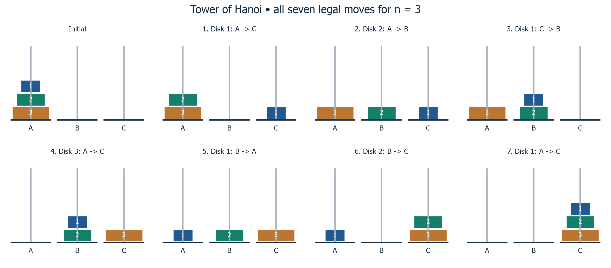

### 2.2 Implementation and execution

hanoi() yields moves without storing them all. The CLI maintains three list-based peg stacks, checks each pop/append for legality and prints every state. Invalid disk counts are rejected. The CLI permits 0..15 disks to prevent enormous output; the algorithm has no artificial maximum, but recursion and resource limits still apply.

### 2.3 Execution evidence

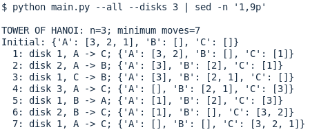

The displayed peg lists are bottom-to-top. Before each transfer, the demonstration checks that the requested disk is on top of the source and smaller than the current target top. The final state has all disks on C. Automated simulations also check n=0..8; zero disks correctly emits no moves.

## 3. Binary tree and traversals

The provided figure is a perfect binary tree labelled in level order from 1 to 31. Node 1 is the root. Each internal node i=1..15 has left child 2i and right child 2i+1. Nodes 16..31 are leaves. The tree has 31 nodes, 15 internal nodes, 16 leaves and height four edges (five levels). This is not a binary search tree: numeric labels encode the pictured structure, not an ordering rule. [1]

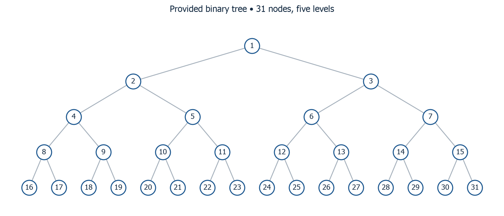

| Parent | Left child | Right child |
| --- | --- | --- |
| 1 | 2 | 3 |
| 2 | 4 | 5 |
| 3 | 6 | 7 |
| 4 | 8 | 9 |
| 5 | 10 | 11 |
| 6 | 12 | 13 |
| 7 | 14 | 15 |
| 8 | 16 | 17 |
| 9 | 18 | 19 |
| 10 | 20 | 21 |
| 11 | 22 | 23 |
| 12 | 24 | 25 |
| 13 | 26 | 27 |
| 14 | 28 | 29 |
| 15 | 30 | 31 |

### 3.1 Pre-order

Rule: root, left, right. Visit root 1, then complete the subtree rooted at 2 before entering the subtree rooted at 3. The first visits are 1,2,4,8,16,17.

Complete visitation sequence: 1, 2, 4, 8, 16, 17, 9, 18, 19, 5, 10, 20, 21, 11, 22, 23, 3, 6, 12, 24, 25, 13, 26, 27, 7, 14, 28, 29, 15, 30, 31.

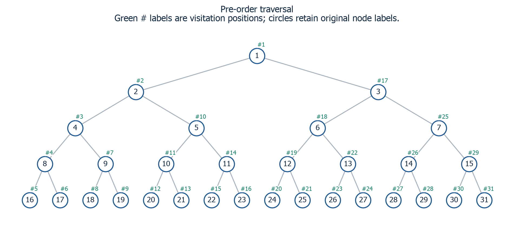

Every node is visited exactly once. The recursive traversals append into one result list, avoiding repeated list concatenation. Level-order uses collections.deque and popleft for efficient FIFO behavior. [3]

### 3.2 In-order

Rule: left, root, right. Descend to leaf 16 first, visit its parent 8 after the left subtree, then visit 17. Root 1 is visited only after all 15 nodes in its left subtree.

Complete visitation sequence: 16, 8, 17, 4, 18, 9, 19, 2, 20, 10, 21, 5, 22, 11, 23, 1, 24, 12, 25, 6, 26, 13, 27, 3, 28, 14, 29, 7, 30, 15, 31.

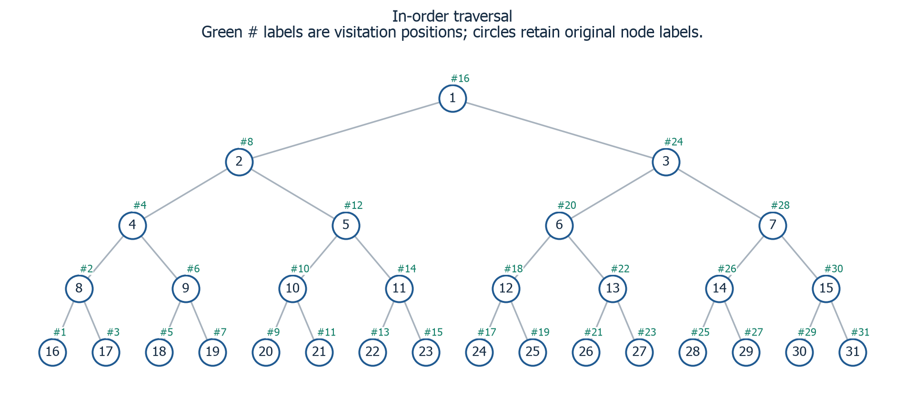

Every node is visited exactly once. The recursive traversals append into one result list, avoiding repeated list concatenation. Level-order uses collections.deque and popleft for efficient FIFO behavior. [3]

### 3.3 Post-order

Rule: left, right, root. Visit both children before their parent. Nodes 16 and 17 precede node 8. The root is the final visit.

Complete visitation sequence: 16, 17, 8, 18, 19, 9, 4, 20, 21, 10, 22, 23, 11, 5, 2, 24, 25, 12, 26, 27, 13, 6, 28, 29, 14, 30, 31, 15, 7, 3, 1.

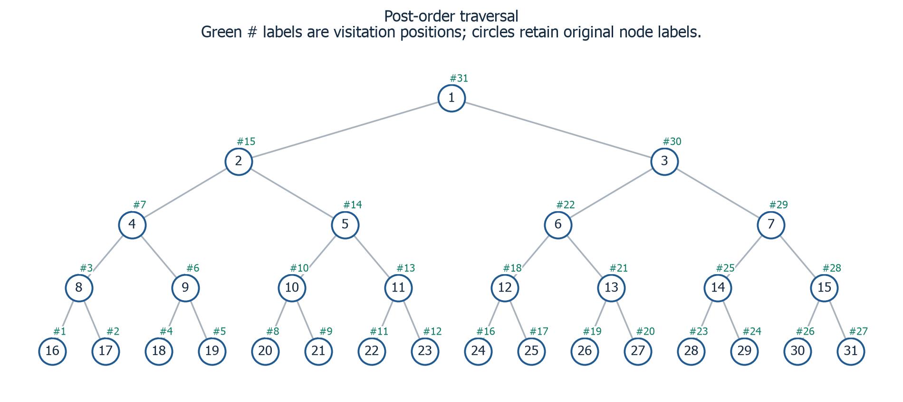

Every node is visited exactly once. The recursive traversals append into one result list, avoiding repeated list concatenation. Level-order uses collections.deque and popleft for efficient FIFO behavior. [3]

### 3.4 Level-order

Rule: breadth first, FIFO queue. Start with root 1 in a queue. Repeatedly dequeue a node, visit it, then enqueue its left and right children. The five levels appear in increasing label order.

Complete visitation sequence: 1, 2, 3, 4, 5, 6, 7, 8, 9, 10, 11, 12, 13, 14, 15, 16, 17, 18, 19, 20, 21, 22, 23, 24, 25, 26, 27, 28, 29, 30, 31.

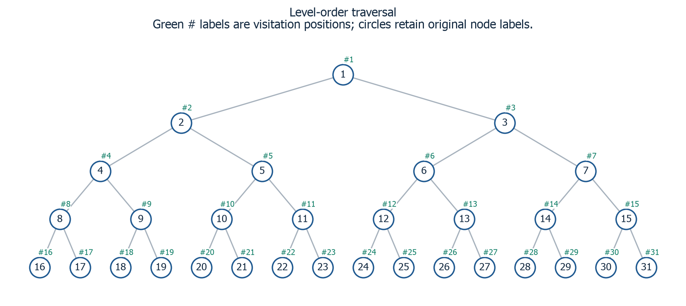

Every node is visited exactly once. The recursive traversals append into one result list, avoiding repeated list concatenation. Level-order uses collections.deque and popleft for efficient FIFO behavior. [3]

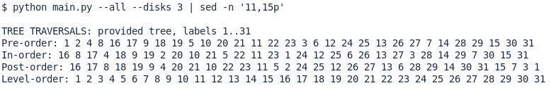

## 4. Huffman coding

The input frequencies are a=2, b=4, c=8, d=16 and e=16, totaling 46 symbols. Huffman's greedy construction repeatedly combines the two least-frequent nodes into a new parent, until one tree remains. Codes are root-to-leaf paths. A min-heap supports each selection; serial numbers ensure equal weights never cause Python to compare non-orderable node objects. [1,2]

### 4.1 Step-by-step heap construction

| Step | Two minimum nodes | Parent | Remaining weights |
| --- | --- | --- | --- |
| 1 | a:2 + b:4 | 6 | 6,8,16,16 |
| 2 | (a+b):6 + c:8 | 14 | 14,16,16 |
| 3 | ((a+b)+c):14 + d:16 | 30 | 16,30 |
| 4 | e:16 + (((a+b)+c)+d):30 | 46 | 46 (root) |

For the tied frequencies of d and e, d enters the heap first because symbols are sorted. At the third merge d is therefore selected with the weight-14 subtree. At the last merge e is the left child. Other valid tie choices can produce different bit strings with the same optimal weighted cost. The resulting code is prefix-free because symbols occur only at leaves.

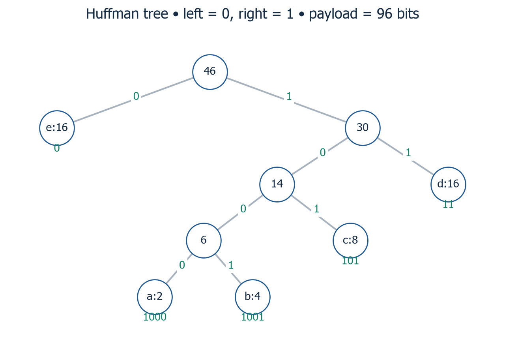

### 4.2 Final codes and encoded payload length

| Symbol | Frequency | Code | Length (bits) | Contribution (bits) |
| --- | --- | --- | --- | --- |
| a | 2 | 1000 | 4 | 8 |
| b | 4 | 1001 | 4 | 16 |
| c | 8 | 101 | 3 | 24 |
| d | 16 | 11 | 2 | 32 |
| e | 16 | 0 | 1 | 16 |

Weighted encoded length = 2(4)+4(4)+8(3)+16(2)+16(1) = 8+16+24+32+16 = 96 bits. The merge-sum check gives 6+14+30+46=96 as well. Average length is 96/46, approximately 2.087 bits per symbol. A fixed-length code for five symbols requires ceil(log2 5)=3 bits per symbol, giving 138 bits; Huffman saves 42 payload bits, approximately 30.4%, before any header or codebook overhead.

The brief does not supply an ordered message. For reproducibility only, this demonstration places a twice, b four times, c eight times, d sixteen times and e sixteen times, in grouped alphabetical order. Any other order with the same counts has the same 96-bit length but usually a different encoded bit string.

```text
Message: aabbbbccccccccddddddddddddddddeeeeeeeeeeeeeeee
Encoded: 100010001001100110011001101101101101101101101101111111111111111111111111111111110000000000000000
```

Decoding the encoded string reproduces the exact demonstration message. The 96-bit payload packs into 12 bytes with no padding. This is not a full compressed-file size: a file format would also store decoding information and other metadata. The Python demo prints bits as text and does not claim to implement a binary container format.

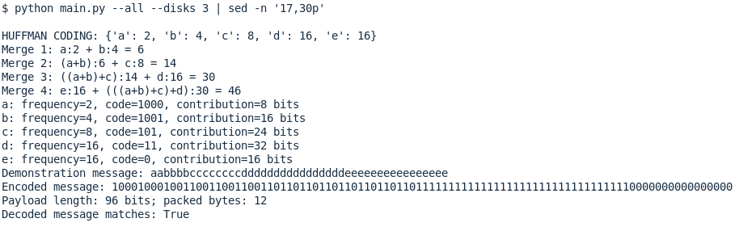

## 5. Weighted graphs — Dijkstra and Prim

Both source figures are transcribed as simple undirected weighted graphs. Figure 1 has vertices A..L and Figure 2 has vertices A..J; each has 19 edges. Every weight used by the algorithms is listed below and appears in the diagrams and matrices. Algorithm tests validate the computations on this transcription; visually checking the transcription against the scanned handout is a separate step. [1]

| Figure 1 edge | Weight | Figure 2 edge | Weight |
| --- | --- | --- | --- |
| A-D | 4 | A-B | 2 |
| B-D | 8 | A-D | 15 |
| B-C | 2 | A-I | 9 |
| C-E | 5 | B-C | 3 |
| C-J | 10 | B-D | 5 |
| D-F | 6 | B-E | 17 |
| D-G | 3 | C-E | 12 |
| D-H | 9 | C-F | 18 |
| D-K | 6 | D-E | 4 |
| F-G | 1 | D-G | 6 |
| F-K | 7 | E-F | 13 |
| G-K | 4 | E-G | 11 |
| H-K | 6 | E-H | 7 |
| H-E | 4 | F-H | 14 |
| H-I | 3 | G-H | 19 |
| E-I | 9 | G-I | 8 |
| E-J | 2 | G-J | 1 |
| I-J | 7 | H-J | 16 |
| J-L | 1 | I-J | 1 |

### 5.1 Dijkstra method and tie handling

Initialize distance[A]=0 and all other distances to infinity. Repeatedly pop the unsettled vertex of minimum tentative distance, settle it, and relax every incident edge: if distance[u]+weight(u,v) improves distance[v], update that distance, record predecessor[v]=u and push a new heap entry. Skip entries for already settled vertices. Since all edge weights are non-negative, a settled minimum cannot later be improved through an unsettled vertex. [4]

The implementation uses heap entries (distance, vertex), so alphabetic vertex order resolves equal tentative distances. Neighbors are processed alphabetically and predecessors change only for strictly smaller costs. Equal-cost alternative paths remain valid even if a different implementation reports another predecessor. The algorithm runs to completion, so it returns shortest paths from A to every actual vertex, not only the example destination.

### 5.2 Prim method and distinction from shortest paths

Begin the tree at A. Put incident candidate edges into a min-heap, select the cheapest edge reaching an unvisited vertex, add that vertex and push its eligible incident edges. Discard heap entries whose destination is already visited. Each selected edge crosses the current visited/unvisited cut; the minimum such edge is safe for an MST. Heap tuples (weight, source, target) resolve ties lexicographically. A connected V-vertex graph produces V-1 tree edges. [5]

Dijkstra minimizes each path's accumulated cost from A. Prim minimizes the sum of all edges connecting the graph; the start vertex is merely where construction begins. An MST is generally not a shortest-path tree. This project applies both algorithms to both figures and labels their objectives separately.

### 5.3 Figure 1: graph and adjacency matrix

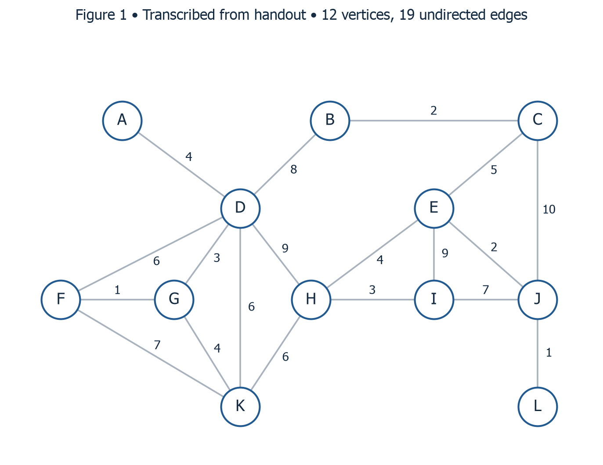

Matrix convention: diagonal 0; off-diagonal inf means no direct edge, not zero cost. Symmetry records the undirected interpretation. Row and column order is alphabetical.

|  | A | B | C | D | E | F | G | H | I | J | K | L |
| --- | --- | --- | --- | --- | --- | --- | --- | --- | --- | --- | --- | --- |
| A | 0 | inf | inf | 4 | inf | inf | inf | inf | inf | inf | inf | inf |
| B | inf | 0 | 2 | 8 | inf | inf | inf | inf | inf | inf | inf | inf |
| C | inf | 2 | 0 | inf | 5 | inf | inf | inf | inf | 10 | inf | inf |
| D | 4 | 8 | inf | 0 | inf | 6 | 3 | 9 | inf | inf | 6 | inf |
| E | inf | inf | 5 | inf | 0 | inf | inf | 4 | 9 | 2 | inf | inf |
| F | inf | inf | inf | 6 | inf | 0 | 1 | inf | inf | inf | 7 | inf |
| G | inf | inf | inf | 3 | inf | 1 | 0 | inf | inf | inf | 4 | inf |
| H | inf | inf | inf | 9 | 4 | inf | inf | 0 | 3 | inf | 6 | inf |
| I | inf | inf | inf | inf | 9 | inf | inf | 3 | 0 | 7 | inf | inf |
| J | inf | inf | 10 | inf | 2 | inf | inf | inf | 7 | 0 | inf | 1 |
| K | inf | inf | inf | 6 | inf | 7 | 4 | 6 | inf | inf | 0 | inf |
| L | inf | inf | inf | inf | inf | inf | inf | inf | inf | 1 | inf | 0 |

### Figure 1: Dijkstra step-by-step

Each row settles the named vertex at its final shortest distance and records all successful relaxations after inspecting its edges. Unlisted neighbors are not improved. Stale heap entries are skipped and do not constitute an additional settlement.

| Step | Settle | Cost | Successful relaxation(s) |
| --- | --- | --- | --- |
| 1 | A | 0 | D: inf -> 4 via A |
| 2 | D | 4 | B: inf -> 12 via D; F: inf -> 10 via D; G: inf -> 7 via D; H: inf -> 13 via D; K: inf -> 10 via D |
| 3 | G | 7 | F: 10 -> 8 via G |
| 4 | F | 8 | No improvements |
| 5 | K | 10 | No improvements |
| 6 | B | 12 | C: inf -> 14 via B |
| 7 | H | 13 | E: inf -> 17 via H; I: inf -> 16 via H |
| 8 | C | 14 | J: inf -> 24 via C |
| 9 | I | 16 | J: 24 -> 23 via I |
| 10 | E | 17 | J: 23 -> 19 via E |
| 11 | J | 19 | L: inf -> 20 via J |
| 12 | L | 20 | No improvements |

### Tentative distances after each settlement

| Step | Node | A | B | C | D | E | F | G | H | I | J | K | L |
| --- | --- | --- | --- | --- | --- | --- | --- | --- | --- | --- | --- | --- | --- |
| 1 | A | 0 | inf | inf | 4 | inf | inf | inf | inf | inf | inf | inf | inf |
| 2 | D | 0 | 12 | inf | 4 | inf | 10 | 7 | 13 | inf | inf | 10 | inf |
| 3 | G | 0 | 12 | inf | 4 | inf | 8 | 7 | 13 | inf | inf | 10 | inf |
| 4 | F | 0 | 12 | inf | 4 | inf | 8 | 7 | 13 | inf | inf | 10 | inf |
| 5 | K | 0 | 12 | inf | 4 | inf | 8 | 7 | 13 | inf | inf | 10 | inf |
| 6 | B | 0 | 12 | 14 | 4 | inf | 8 | 7 | 13 | inf | inf | 10 | inf |
| 7 | H | 0 | 12 | 14 | 4 | 17 | 8 | 7 | 13 | 16 | inf | 10 | inf |
| 8 | C | 0 | 12 | 14 | 4 | 17 | 8 | 7 | 13 | 16 | 24 | 10 | inf |
| 9 | I | 0 | 12 | 14 | 4 | 17 | 8 | 7 | 13 | 16 | 23 | 10 | inf |
| 10 | E | 0 | 12 | 14 | 4 | 17 | 8 | 7 | 13 | 16 | 19 | 10 | inf |
| 11 | J | 0 | 12 | 14 | 4 | 17 | 8 | 7 | 13 | 16 | 19 | 10 | 20 |
| 12 | L | 0 | 12 | 14 | 4 | 17 | 8 | 7 | 13 | 16 | 19 | 10 | 20 |

### Figure 1: shortest paths from A

| Target | Final cost | Path |
| --- | --- | --- |
| A | 0 | A |
| B | 12 | A -> D -> B |
| C | 14 | A -> D -> B -> C |
| D | 4 | A -> D |
| E | 17 | A -> D -> H -> E |
| F | 8 | A -> D -> G -> F |
| G | 7 | A -> D -> G |
| H | 13 | A -> D -> H |
| I | 16 | A -> D -> H -> I |
| J | 19 | A -> D -> H -> E -> J |
| K | 10 | A -> D -> K |
| L | 20 | A -> D -> H -> E -> J -> L |

Required destination L: the lowest-cost path is A -> D -> H -> E -> J -> L. Its total is 4+9+4+2+1=20. The intermediate predecessor chain confirms the same route when followed backward from L. The shortest-path tree rooted at A has total edge weight 43, which is not the MST's 35.

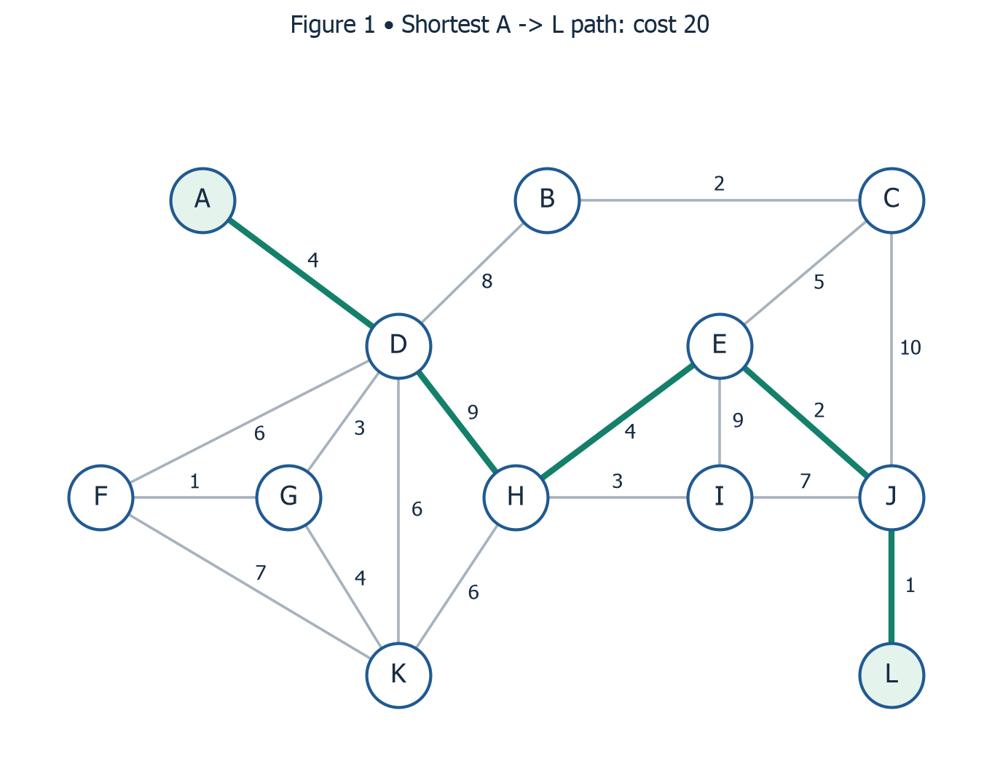

### Figure 1: Prim construction and MST

| Step | Selected edge | Edge weight | Cumulative weight |
| --- | --- | --- | --- |
| 1 | A-D | 4 | 4 |
| 2 | D-G | 3 | 7 |
| 3 | G-F | 1 | 8 |
| 4 | G-K | 4 | 12 |
| 5 | K-H | 6 | 18 |
| 6 | H-I | 3 | 21 |
| 7 | H-E | 4 | 25 |
| 8 | E-J | 2 | 27 |
| 9 | J-L | 1 | 28 |
| 10 | E-C | 5 | 33 |
| 11 | C-B | 2 | 35 |

The resulting tree has 11 edges for 12 vertices, reaches every vertex without adding a cycle, and has total weight 35. An independent Kruskal implementation confirms this total for every chosen starting vertex.

The Figure 1 MST path from A to L is A-D-G-K-H-E-J-L, cost 4+3+4+6+4+2+1=24. It is longer than Dijkstra's cost-20 path, providing a concrete demonstration that an MST does not solve the shortest-path objective.

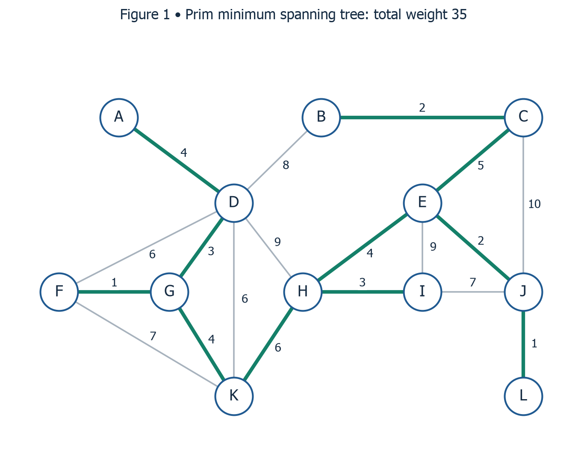

### Figure 1: actual execution evidence

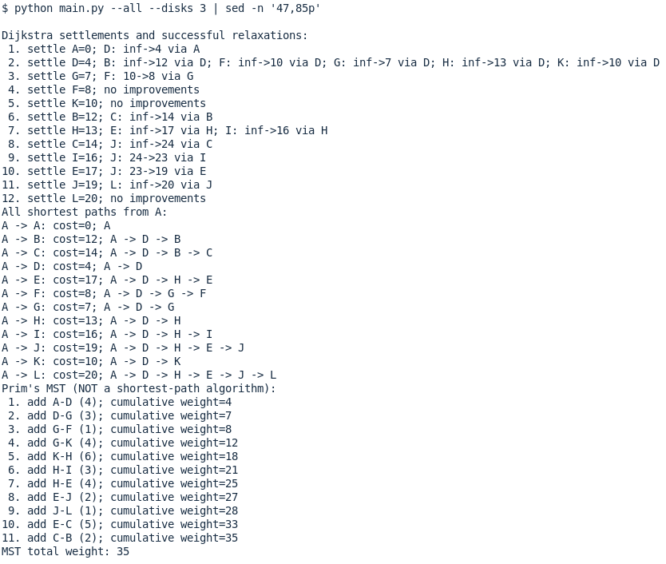

The screenshot command filters the corresponding portion of a fresh complete run only for readability. The unfiltered run is preserved in outputs/execution.txt; the machine-readable counterpart is outputs/results.json.

### 5.4 Figure 2: graph and adjacency matrix

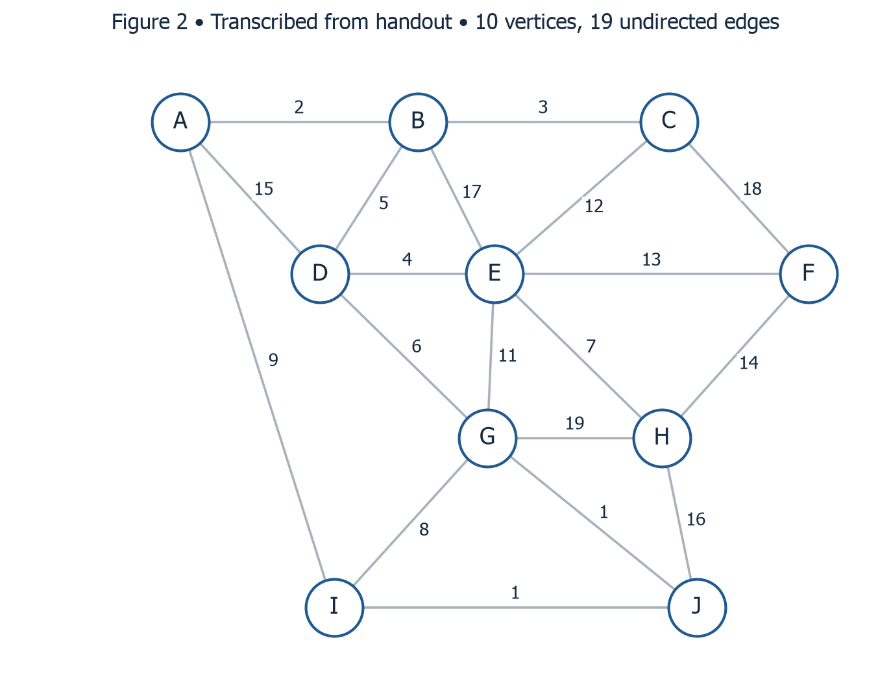

Matrix convention: diagonal 0; off-diagonal inf means no direct edge, not zero cost. Symmetry records the undirected interpretation. Row and column order is alphabetical.

|  | A | B | C | D | E | F | G | H | I | J |
| --- | --- | --- | --- | --- | --- | --- | --- | --- | --- | --- |
| A | 0 | 2 | inf | 15 | inf | inf | inf | inf | 9 | inf |
| B | 2 | 0 | 3 | 5 | 17 | inf | inf | inf | inf | inf |
| C | inf | 3 | 0 | inf | 12 | 18 | inf | inf | inf | inf |
| D | 15 | 5 | inf | 0 | 4 | inf | 6 | inf | inf | inf |
| E | inf | 17 | 12 | 4 | 0 | 13 | 11 | 7 | inf | inf |
| F | inf | inf | 18 | inf | 13 | 0 | inf | 14 | inf | inf |
| G | inf | inf | inf | 6 | 11 | inf | 0 | 19 | 8 | 1 |
| H | inf | inf | inf | inf | 7 | 14 | 19 | 0 | inf | 16 |
| I | 9 | inf | inf | inf | inf | inf | 8 | inf | 0 | 1 |
| J | inf | inf | inf | inf | inf | inf | 1 | 16 | 1 | 0 |

### Figure 2: Dijkstra step-by-step

Each row settles the named vertex at its final shortest distance and records all successful relaxations after inspecting its edges. Unlisted neighbors are not improved. Stale heap entries are skipped and do not constitute an additional settlement.

| Step | Settle | Cost | Successful relaxation(s) |
| --- | --- | --- | --- |
| 1 | A | 0 | B: inf -> 2 via A; D: inf -> 15 via A; I: inf -> 9 via A |
| 2 | B | 2 | C: inf -> 5 via B; D: 15 -> 7 via B; E: inf -> 19 via B |
| 3 | C | 5 | E: 19 -> 17 via C; F: inf -> 23 via C |
| 4 | D | 7 | E: 17 -> 11 via D; G: inf -> 13 via D |
| 5 | I | 9 | J: inf -> 10 via I |
| 6 | J | 10 | G: 13 -> 11 via J; H: inf -> 26 via J |
| 7 | E | 11 | H: 26 -> 18 via E |
| 8 | G | 11 | No improvements |
| 9 | H | 18 | No improvements |
| 10 | F | 23 | No improvements |

### Tentative distances after each settlement

| Step | Node | A | B | C | D | E | F | G | H | I | J |
| --- | --- | --- | --- | --- | --- | --- | --- | --- | --- | --- | --- |
| 1 | A | 0 | 2 | inf | 15 | inf | inf | inf | inf | 9 | inf |
| 2 | B | 0 | 2 | 5 | 7 | 19 | inf | inf | inf | 9 | inf |
| 3 | C | 0 | 2 | 5 | 7 | 17 | 23 | inf | inf | 9 | inf |
| 4 | D | 0 | 2 | 5 | 7 | 11 | 23 | 13 | inf | 9 | inf |
| 5 | I | 0 | 2 | 5 | 7 | 11 | 23 | 13 | inf | 9 | 10 |
| 6 | J | 0 | 2 | 5 | 7 | 11 | 23 | 11 | 26 | 9 | 10 |
| 7 | E | 0 | 2 | 5 | 7 | 11 | 23 | 11 | 18 | 9 | 10 |
| 8 | G | 0 | 2 | 5 | 7 | 11 | 23 | 11 | 18 | 9 | 10 |
| 9 | H | 0 | 2 | 5 | 7 | 11 | 23 | 11 | 18 | 9 | 10 |
| 10 | F | 0 | 2 | 5 | 7 | 11 | 23 | 11 | 18 | 9 | 10 |

### Figure 2: shortest paths from A

| Target | Final cost | Path |
| --- | --- | --- |
| A | 0 | A |
| B | 2 | A -> B |
| C | 5 | A -> B -> C |
| D | 7 | A -> B -> D |
| E | 11 | A -> B -> D -> E |
| F | 23 | A -> B -> C -> F |
| G | 11 | A -> I -> J -> G |
| H | 18 | A -> B -> D -> E -> H |
| I | 9 | A -> I |
| J | 10 | A -> I -> J |

The requested A-to-L path cannot be defined on Figure 2 because L is not a vertex. This differs from an existing but unreachable vertex. No L, K or connecting edge is invented. As a separate terminal-vertex demonstration, A -> I -> J has total cost 9+1=10. Dijkstra has still computed every actual A-to-vertex shortest path.

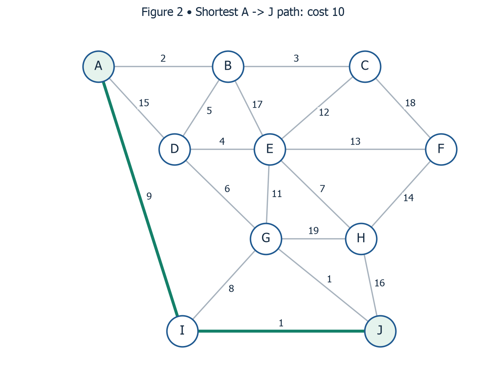

### Figure 2: Prim construction and MST

| Step | Selected edge | Edge weight | Cumulative weight |
| --- | --- | --- | --- |
| 1 | A-B | 2 | 2 |
| 2 | B-C | 3 | 5 |
| 3 | B-D | 5 | 10 |
| 4 | D-E | 4 | 14 |
| 5 | D-G | 6 | 20 |
| 6 | G-J | 1 | 21 |
| 7 | J-I | 1 | 22 |
| 8 | E-H | 7 | 29 |
| 9 | E-F | 13 | 42 |

The resulting tree has 9 edges for 10 vertices, reaches every vertex without adding a cycle, and has total weight 42. An independent Kruskal implementation confirms this total for every chosen starting vertex.

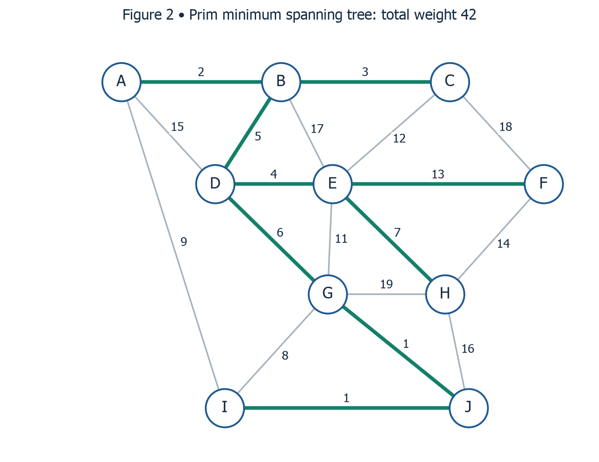

### Figure 2: actual execution evidence

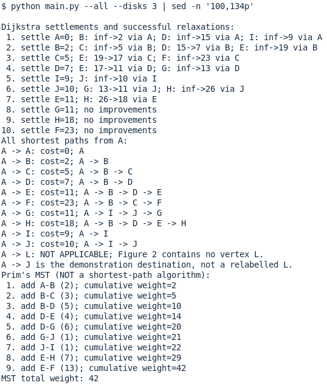

The screenshot command filters the corresponding portion of a fresh complete run only for readability. The unfiltered run is preserved in outputs/execution.txt; the machine-readable counterpart is outputs/results.json.

## 6. Complexity and validation

Notation: n disks; N tree nodes; h tree height; w maximum queue width; k Huffman symbols; L total codebook bit-string lengths; V vertices; E undirected edges. Output storage and educational tracing are distinguished from core auxiliary storage.

| Operation | Time | Space / notes |
| --- | --- | --- |
| Hanoi recursive work | Theta(2^n) calls/moves | O(n) stack. Nested Python yield-from propagation can add up to O(n) dispatch per move, so generator runtime is bounded by O(n 2^n). |
| Recursive tree traversal | Theta(N) | O(h) stack plus Theta(N) result list. |
| Level-order traversal | Theta(N) | O(w) queue plus Theta(N) result list. |
| Huffman heap construction | O(k log k) | O(k) tree and heap. |
| Huffman code generation | O(k+L) | O(k+L) tree/code storage; depth up to k-1. |
| Encode/decode | Linear in input plus emitted bits/symbols | Stored bit-string and decoded output are linear in their lengths. |
| Graph adjacency lists | O(V+E) | O(V+E); undirected edges stored twice. |
| Adjacency matrix | Theta(V^2) | Theta(V^2), generated for documentation. |
| Dijkstra, core heap work | O((V+E) log V) on simple graphs | O(V+E) graph/heap/maps; lazy duplicate heap entries can occupy O(E). |
| Prim, core lazy heap work | O((V+E) log V) on simple graphs | O(V+E) graph/heap/tree; only connected graphs accepted. |
| Tracing in these implementations | Additional O(V^2) time | Additional O(V^2) snapshot storage: Dijkstra distance maps and Prim visited sets. |

Hanoi's standard recursive algorithm has Theta(2^n) work; this memory-efficient Python generator additionally passes yielded moves through suspended generator frames. Materializing all moves would require Theta(2^n) storage instead. For a connected simple graph, E>=V-1 and log E=O(log V), so lazy-heap core work is commonly stated as O(E log V). Sorting neighbors for reproducible traces is within this bound. Retained per-step snapshots make the complete traced graph routines O((V+E) log V+V^2) in time and O(V+E+V^2) in storage. These bounds distinguish textbook algorithms from implementation and reporting overhead.

### 6.1 Test strategy

| Area | Checks performed |
| --- | --- |
| Hanoi | Simulate every move for n=0..8; verify top-disk legality, minimum counts, final states, exact n=3 sequence and rejected invalid inputs. |
| Tree | Compare all four full sequences with independently specified expected lists; verify every 2i/2i+1 link, all leaves, empty and one-node trees, and a skewed tree. |
| Huffman | Check deterministic codes, contributions, merge sum, prefix-free property, empty/large randomized round trips, one-symbol alphabet and malformed inputs. Exhaustively enumerate feasible five-symbol lengths 1..4 under Kraft's inequality to independently confirm the optimal 96-bit cost. |
| Dijkstra | Compare all-source distances on both assignment graphs with independent Floyd-Warshall; validate reconstructed edge-path costs; test absent L, zero weights, disconnection and invalid graphs. |
| Prim | Compare totals with independent Kruskal for every start vertex on both assignment graphs; check V-1 edge counts and vertex coverage; test a singleton and disconnection. |
| Additional graphs | Use deterministic seed 320 to generate nine connected graphs of sizes 2..10. Cross-check paths and MSTs against the independent algorithms. |
| Packaging | Compile Python files; verify generated figures, execution evidence and PDF; check ZIP extraction and rerun all tests from the extracted folder. |

All 19 unittest methods pass. Parameterized loops and subtests cover many more input cases than the method count. Tests can prove consistency of implementations and oracles on the chosen inputs; they do not by themselves prove the scanned image was transcribed perfectly. The explicit edge inventory and diagrams make that interpretation auditable.

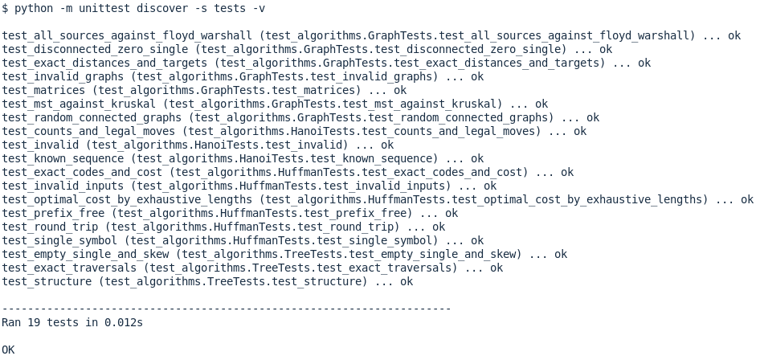

```text
python -m unittest discover -s tests -v
python main.py --all --disks 3 --json outputs/results.json
```

## 7. Conclusion, reflection and submission

The project implements every described algorithm and reproduces the supplied tree, frequencies and weighted graphs. Hanoi demonstrates recursive decomposition and LIFO legality; tree traversal contrasts recursive depth-first order with FIFO breadth-first order; Huffman demonstrates optimal prefix coding; and the graph solutions contrast shortest-path and spanning-tree optimization. Verified numerical results are seven moves for three disks, a 96-bit Huffman payload, Figure 1 A-to-L cost 20, Figure 1 MST weight 35, and Figure 2 MST weight 42. Figure 2's missing L is stated explicitly.

### 7.1 Technical reflection

The main implementation challenges are preserving the scanned graph's edge weights, handling equal-priority Huffman nodes deterministically, making base cases and invalid-input behavior explicit, and separating algorithm logic from printing. Returned data enables independent tests; generators avoid storing Hanoi's exponential output; append-based traversals keep linear runtime. The step traces improve explainability but deliberately use quadratic snapshot storage.

A valid personal reflection must come from the actual group members. Before submission, add what each member genuinely learned, the changes they actually made, and any real difficulties they encountered. These technical observations are not presented as fabricated first-person experiences. Follow the university's academic-integrity and assistance-disclosure rules in the supplied brief. [1]

### 7.2 Submission and remaining user-side actions

The software/report package includes source, tests, complete output logs, a printable PDF, editable Markdown, diagrams, real terminal screenshots, GitHub instructions and individual presentation notes. Fill in genuine names and IDs. Upload the ZIP and project to your own GitHub repository, invite the verified lecturer as collaborator, and submit the link. Print the report and prepare the live presentation. No GitHub upload, invitation, printing or live presentation is claimed to have occurred.

The brief states Week 4 rather than a calendar deadline. Confirm the actual due date with the lecturer. SUBMISSION_CHECKLIST.md gives the upload/print checklist; PRESENTATION_NOTES.md gives an 8–10 minute demo plan and viva answers. No repository URL, lecturer username or group contribution is invented.

## References

[1] Limkokwing University of Creative Technology, Sierra Leone. DCOMP320 Data Structures and Algorithm Final Project, supplied four-page scanned brief, semester September 2026–February 2027. Primary source for requirements, tree, frequencies and graph figures.

[2] Python Software Foundation. heapq — Heap queue algorithm, including priority queue implementation notes. https://docs.python.org/3/library/heapq.html (accessed 14 November 2026).

[3] Python Software Foundation. collections — Container datatypes, deque documentation. https://docs.python.org/3/library/collections.html (accessed 14 November 2026).

[4] Sedgewick, R. and Wayne, K. Algorithms, 4th edition companion: 4.4 Shortest Paths. Princeton University. https://algs4.cs.princeton.edu/44sp/ (accessed 14 November 2026).

[5] Sedgewick, R. and Wayne, K. Algorithms, 4th edition companion: 4.3 Minimum Spanning Trees. Princeton University. https://algs4.cs.princeton.edu/43mst/ (accessed 14 November 2026).

All numerical answers, traversal sequences, diagrams and traces are computed from the assignment data by the submitted Python source. Local HTML copies of external documentation are retained in project.report/sources for audit; external references support algorithm/library descriptions, not substitutes for the project's computations.

## Appendix A. Full source: src/algorithms.py

hanoi is the recursive generator. TreeNode and assignment_tree reconstruct the figure; the traversal functions accumulate results and levelorder uses a deque. HuffmanNode and huffman build the stable heap tree, then encode/decode demonstrate the prefix code. FIGURE_1_EDGES and FIGURE_2_EDGES are the exact graph inventory. make_graph validates symmetry and weights; adjacency_matrix documents non-edges with infinity. dijkstra settles vertices and stores predecessor/trace data; reconstruct_path follows the predecessor chain; prim selects crossing edges and records the MST.

Line numbers below are report annotations, not part of the source file. Long lines soft-wrap visually at the page width; use the original .py file when running or copying code.

```python
"""DCOMP320 solutions; Python 3.10+, standard library only.

All algorithms return data so they can be tested independently of the CLI.
"""
from __future__ import annotations

from collections import deque
from dataclasses import dataclass
import heapq
from itertools import count
from math import inf, isfinite
from typing import Iterator


def hanoi(n: int, source: str = "A", auxiliary: str = "B",
          target: str = "C") -> Iterator[tuple[int, str, str]]:
    """Yield legal moves (disk, from, to), smallest disk numbered 1."""
    if isinstance(n, bool) or not isinstance(n, int) or n < 0:
        raise ValueError("Number of disks must be a non-negative integer.")
    if len({source, auxiliary, target}) != 3:
        raise ValueError("Three distinct peg names are required.")

    def solve(k: int, start: str, spare: str, end: str):
        if k == 0:
            return
        yield from solve(k - 1, start, end, spare)
        yield k, start, end
        yield from solve(k - 1, spare, start, end)

    return solve(n, source, auxiliary, target)


@dataclass
class TreeNode:
    value: int
    left: TreeNode | None = None
    right: TreeNode | None = None


def assignment_tree() -> TreeNode:
    """Reproduce the exact perfect binary tree 1..31 in the handout."""
    nodes = {i: TreeNode(i) for i in range(1, 32)}
    for i in range(1, 16):
        nodes[i].left, nodes[i].right = nodes[2 * i], nodes[2 * i + 1]
    return nodes[1]


def preorder(root: TreeNode | None) -> list[int]:
    result = []
    def visit(node):
        if node is not None:
            result.append(node.value)
            visit(node.left)
            visit(node.right)
    visit(root)
    return result


def inorder(root: TreeNode | None) -> list[int]:
    result = []
    def visit(node):
        if node is not None:
            visit(node.left)
            result.append(node.value)
            visit(node.right)
    visit(root)
    return result


def postorder(root: TreeNode | None) -> list[int]:
    result = []
    def visit(node):
        if node is not None:
            visit(node.left)
            visit(node.right)
            result.append(node.value)
    visit(root)
    return result


def levelorder(root: TreeNode | None) -> list[int]:
    if root is None:
        return []
    queue, result = deque([root]), []
    while queue:
        node = queue.popleft()
        result.append(node.value)
        if node.left is not None:
            queue.append(node.left)
        if node.right is not None:
            queue.append(node.right)
    return result


@dataclass
class HuffmanNode:
    frequency: int
    symbol: str | None = None
    left: HuffmanNode | None = None
    right: HuffmanNode | None = None


def huffman(frequencies: dict[str, int]):
    """Return (root, codes, merges) with stable, documented tie breaking.

    Leaves enter in sorted symbol order; new parents follow existing nodes
    when their weights tie. The first popped child gets bit 0.
    """
    if not frequencies:
        raise ValueError("At least one symbol is required.")
    if any(not isinstance(s, str) or len(s) != 1 for s in frequencies):
        raise ValueError("Symbols must be single characters.")
    if any(isinstance(f, bool) or not isinstance(f, int) or f <= 0
           for f in frequencies.values()):
        raise ValueError("Frequencies must be positive integers.")
    serial = count()
    heap = [(frequencies[s], next(serial), HuffmanNode(frequencies[s], s), s)
            for s in sorted(frequencies)]
    heapq.heapify(heap)
    merges = []
    while len(heap) > 1:
        f1, _, left, label1 = heapq.heappop(heap)
        f2, _, right, label2 = heapq.heappop(heap)
        parent = HuffmanNode(f1 + f2, left=left, right=right)
        label = "(" + label1 + "+" + label2 + ")"
        merges.append((label1, f1, label2, f2, f1 + f2))
        heapq.heappush(heap, (f1 + f2, next(serial), parent, label))
    root = heap[0][2]
    codes = {}

    def walk(node: HuffmanNode, prefix: str):
        if node.symbol is not None:
            codes[node.symbol] = prefix or "0"
        else:
            walk(node.left, prefix + "0")
            walk(node.right, prefix + "1")

    walk(root, "")
    return root, codes, merges


def encode(text: str, codes: dict[str, str]) -> str:
    if any(symbol not in codes for symbol in text):
        raise ValueError("Text contains a symbol absent from the codebook.")
    return "".join(codes[s] for s in text)


def decode(bits: str, root: HuffmanNode) -> str:
    if any(bit not in "01" for bit in bits):
        raise ValueError("Encoded text must contain only 0 and 1.")
    if root.symbol is not None:
        if "1" in bits:
            raise ValueError("Single-symbol code is 0.")
        return root.symbol * len(bits)
    result, node = [], root
    for bit in bits:
        node = node.left if bit == "0" else node.right
        if node.symbol is not None:
            result.append(node.symbol)
            node = root
    if node is not root:
        raise ValueError("Incomplete Huffman code at end of input.")
    return "".join(result)


Graph = dict[str, dict[str, int | float]]


def make_graph(edges: list[tuple[str, str, int]],
               vertices: list[str] | None = None) -> Graph:
    graph = {v: {} for v in (vertices or [])}
    for u, v, weight in edges:
        if u == v or v in graph.get(u, {}):
            raise ValueError("Self loops and duplicate edges are not allowed.")
        graph.setdefault(u, {})[v] = weight
        graph.setdefault(v, {})[u] = weight
    validate_graph(graph)
    return dict(sorted(graph.items()))


def validate_graph(graph: Graph):
    """This project uses simple undirected graphs, nonnegative finite weights."""
    for u, neighbors in graph.items():
        for v, weight in neighbors.items():
            if (isinstance(weight, bool) or not isinstance(weight, (int, float))
                    or not isfinite(weight) or weight < 0):
                raise ValueError("Weights must be finite, non-negative numbers.")
            if u == v or v not in graph or graph[v].get(u) != weight:
                raise ValueError("Graph must be simple and undirected.")


FIGURE_1_EDGES = [
    ("A", "D", 4), ("B", "D", 8), ("B", "C", 2),
    ("C", "E", 5), ("C", "J", 10), ("D", "F", 6),
    ("D", "G", 3), ("D", "H", 9), ("D", "K", 6),
    ("F", "G", 1), ("F", "K", 7), ("G", "K", 4),
    ("H", "K", 6), ("H", "E", 4), ("H", "I", 3),
    ("E", "I", 9), ("E", "J", 2), ("I", "J", 7),
    ("J", "L", 1),
]
FIGURE_2_EDGES = [
    ("A", "B", 2), ("A", "D", 15), ("A", "I", 9),
    ("B", "C", 3), ("B", "D", 5), ("B", "E", 17),
    ("C", "E", 12), ("C", "F", 18), ("D", "E", 4),
    ("D", "G", 6), ("E", "F", 13), ("E", "G", 11),
    ("E", "H", 7), ("F", "H", 14), ("G", "H", 19),
    ("G", "I", 8), ("G", "J", 1), ("H", "J", 16),
    ("I", "J", 1),
]


def assignment_graphs() -> dict[str, Graph]:
    return {"Figure 1": make_graph(FIGURE_1_EDGES),
            "Figure 2": make_graph(FIGURE_2_EDGES)}


def adjacency_matrix(graph: Graph):
    vertices = sorted(graph)
    return vertices, [[0 if u == v else graph[u].get(v, inf)
                       for v in vertices] for u in vertices]


def dijkstra(graph: Graph, source: str):
    """Return distances, predecessors and snapshots after each settlement."""
    validate_graph(graph)
    if source not in graph:
        raise ValueError("Source vertex is absent from graph.")
    distances = dict.fromkeys(graph, inf)
    distances[source] = 0
    previous = dict.fromkeys(graph, None)
    heap, settled, trace = [(0, source)], set(), []
    while heap:
        distance, u = heapq.heappop(heap)
        if u in settled:
            continue
        settled.add(u)
        updates = []
        for v, weight in sorted(graph[u].items()):
            candidate = distance + weight
            if v not in settled and candidate < distances[v]:
                old = distances[v]
                distances[v], previous[v] = candidate, u
                heapq.heappush(heap, (candidate, v))
                updates.append((v, old, candidate, u))
        trace.append({"vertex": u, "distance": distance,
                      "updates": updates, "distances": distances.copy()})
    return distances, previous, trace


def reconstruct_path(previous: dict, source: str, target: str) -> list[str]:
    if source not in previous or target not in previous:
        raise ValueError("Requested vertex is absent from graph.")
    result, visited, current = [], set(), target
    while current is not None:
        if current in visited:
            raise ValueError("Predecessor map contains a cycle.")
        visited.add(current)
        result.append(current)
        if current == source:
            return list(reversed(result))
        current = previous[current]
    return []


def prim(graph: Graph, source: str = "A"):
    """Return (chosen edges, total, trace) for a connected graph's MST."""
    validate_graph(graph)
    if source not in graph:
        raise ValueError("Source vertex is absent from graph.")
    visited, heap, edges, trace, total = {source}, [], [], [], 0
    vertex_order = sorted(graph)

    def push_edges(u):
        for v, weight in sorted(graph[u].items()):
            if v not in visited:
                heapq.heappush(heap, (weight, u, v))

    push_edges(source)
    while heap and len(visited) < len(graph):
        weight, u, v = heapq.heappop(heap)
        if v in visited:
            continue
        visited.add(v)
        edges.append((u, v, weight))
        total += weight
        trace.append({"edge": (u, v, weight), "total": total,
                      "visited": [x for x in vertex_order if x in visited]})
        push_edges(v)
    if len(visited) != len(graph):
        raise ValueError("Graph is disconnected; a spanning tree does not exist.")
    return edges, total, trace
```

## Appendix B. Full source: main.py

The CLI accepts an interactive menu or --all batch mode. demo_hanoi maintains and validates real peg stacks, demo_tree prints all orders, demo_huffman prints merges/codes and a decoded round trip, and demo_graphs prints matrices, settlements, every path and Prim edges for both figures. The JSON option replaces infinity with null for strict JSON output. CLI disk limits protect against accidentally huge demonstrations.

Line numbers below are report annotations, not part of the source file. Long lines soft-wrap visually at the page width; use the original .py file when running or copying code.

```python
"""Interactive menu and reproducible all-problem demonstration."""
import argparse
import json
from pathlib import Path
from math import inf
from src.algorithms import (
    hanoi, assignment_tree, preorder, inorder, postorder, levelorder,
    huffman, encode, decode, assignment_graphs, adjacency_matrix,
    dijkstra, reconstruct_path, prim,
)

FREQUENCIES = {"a": 2, "b": 4, "c": 8, "d": 16, "e": 16}


def fmt(value):
    return "inf" if value == inf else str(value)


def demo_hanoi(n):
    print(f"TOWER OF HANOI: n={n}; minimum moves={2 ** n - 1}")
    pegs = {"A": list(range(n, 0, -1)), "B": [], "C": []}
    print("Initial:", pegs)
    for step, (disk, source, target) in enumerate(hanoi(n), 1):
        if not pegs[source] or pegs[source][-1] != disk:
            raise AssertionError("Disk is not on top of source peg.")
        if pegs[target] and pegs[target][-1] < disk:
            raise AssertionError("Larger disk cannot rest on smaller disk.")
        pegs[source].pop()
        pegs[target].append(disk)
        print(f"{step:3}: disk {disk}, {source} -> {target}; {pegs}")
    return pegs


def demo_tree():
    print("TREE TRAVERSALS: provided tree, labels 1..31")
    root = assignment_tree()
    traversals = {"Pre-order": preorder(root), "In-order": inorder(root),
                  "Post-order": postorder(root), "Level-order": levelorder(root)}
    for name, sequence in traversals.items():
        print(f"{name}: {' '.join(map(str, sequence))}")
    return traversals


def demo_huffman():
    print("HUFFMAN CODING:", FREQUENCIES)
    root, codes, merges = huffman(FREQUENCIES)
    for i, (left, f1, right, f2, total) in enumerate(merges, 1):
        print(f"Merge {i}: {left}:{f1} + {right}:{f2} = {total}")
    for s in sorted(FREQUENCIES):
        print(f"{s}: frequency={FREQUENCIES[s]}, code={codes[s]}, "
              f"contribution={FREQUENCIES[s] * len(codes[s])} bits")
    # A demonstration order only: the handout specifies counts, not a message.
    message = "".join(s * FREQUENCIES[s] for s in sorted(FREQUENCIES))
    encoded = encode(message, codes)
    print("Demonstration message:", message)
    print("Encoded message:", encoded)
    print(f"Payload length: {len(encoded)} bits; packed bytes: {(len(encoded)+7)//8}")
    print("Decoded message matches:", decode(encoded, root) == message)
    return {"codes": codes, "merges": merges, "message": message,
            "encoded": encoded, "bits": len(encoded)}


def demo_graphs():
    results = {}
    for name, graph in assignment_graphs().items():
        print(f"\n{name.upper()}: {len(graph)} vertices, "
              f"{sum(map(len, graph.values())) // 2} undirected edges")
        vertices, matrix = adjacency_matrix(graph)
        print("Adjacency matrix (inf = no edge):")
        print("    " + " ".join(f"{v:>3}" for v in vertices))
        for vertex, row in zip(vertices, matrix):
            print(f"{vertex:>3} " + " ".join(f"{fmt(w):>3}" for w in row))
        distances, previous, trace = dijkstra(graph, "A")
        print("Dijkstra settlements and successful relaxations:")
        for i, step in enumerate(trace, 1):
            changes = "; ".join(f"{v}: {fmt(old)}->{new} via {u}"
                                for v, old, new, u in step["updates"])
            print(f"{i:2}. settle {step['vertex']}={step['distance']}; "
                  + (changes or "no improvements"))
        paths = {}
        print("All shortest paths from A:")
        for vertex in vertices:
            path = reconstruct_path(previous, "A", vertex)
            paths[vertex] = path
            print(f"A -> {vertex}: cost={fmt(distances[vertex])}; "
                  + " -> ".join(path))
        if "L" not in graph:
            print("A -> L: NOT APPLICABLE; Figure 2 contains no vertex L.")
            print("A -> J is the demonstration destination, not a relabelled L.")
        mst, cost, prim_trace = prim(graph, "A")
        print("Prim's MST (NOT a shortest-path algorithm):")
        for i, step in enumerate(prim_trace, 1):
            u, v, w = step["edge"]
            print(f"{i:2}. add {u}-{v} ({w}); cumulative weight={step['total']}")
        print("MST total weight:", cost)
        results[name] = {"vertices": vertices, "matrix": matrix,
                         "distances": distances, "previous": previous,
                         "trace": trace, "paths": paths, "mst": mst,
                         "mst_weight": cost, "prim_trace": prim_trace}
    return results


def run_all(n):
    demo_hanoi(n)
    print()
    tree = demo_tree()
    print()
    compression = demo_huffman()
    graphs = demo_graphs()
    return {"hanoi_n": n, "tree": tree, "huffman": compression, "graphs": graphs}


def main():
    parser = argparse.ArgumentParser(description=__doc__)
    parser.add_argument("--all", action="store_true", help="Run all problems")
    parser.add_argument("--disks", type=int, default=3)
    parser.add_argument("--json", type=Path, help="Save all-demo results to JSON")
    args = parser.parse_args()
    if not 0 <= args.disks <= 15:
        parser.error("For a readable demonstration, --disks must be 0..15.")
    if args.all:
        results = run_all(args.disks)
        if args.json:
            args.json.parent.mkdir(parents=True, exist_ok=True)
            # Replace non-edge infinity with null for standards-compliant JSON.
            def clean(obj):
                if isinstance(obj, dict):
                    return {k: clean(v) for k, v in obj.items()}
                if isinstance(obj, (list, tuple)):
                    return [clean(v) for v in obj]
                return None if obj == inf else obj
            args.json.write_text(json.dumps(clean(results), indent=2) + "\n")
        return
    while True:
        print("\nDCOMP320: 1 Hanoi | 2 Tree | 3 Huffman | 4 Graphs | 5 All | 0 Exit")
        try:
            choice = input("Choice: ").strip()
            if choice == "0":
                return
            if choice in {"1", "5"}:
                n = int(input("Number of disks (0..15): "))
                if not 0 <= n <= 15:
                    raise ValueError("Choose 0..15 disks for a manageable display.")
                run_all(n) if choice == "5" else demo_hanoi(n)
            elif choice == "2":
                demo_tree()
            elif choice == "3":
                demo_huffman()
            elif choice == "4":
                demo_graphs()
            else:
                print("Choose 0, 1, 2, 3, 4 or 5.")
        except ValueError as error:
            print("Input error:", error)
        except (EOFError, KeyboardInterrupt):
            print("\nGoodbye.")
            return


if __name__ == "__main__":
    main()
```

## Appendix C. Full source: tests/test_algorithms.py

Floyd-Warshall and Kruskal are independent oracle implementations, not calls back into Dijkstra or Prim. Test classes cover known examples, boundary/invalid inputs, full tree orders, Huffman optimality and round trips, all-source graph results and deterministically generated random graphs. The exhaustive length search uses Kraft's inequality for independent five-symbol Huffman verification.

Line numbers below are report annotations, not part of the source file. Long lines soft-wrap visually at the page width; use the original .py file when running or copying code.

```python
"""Independent oracles: Floyd-Warshall for paths, Kruskal for MSTs."""
import random
import unittest
from itertools import product
from math import inf
from src.algorithms import *


def floyd_warshall(graph):
    vs, matrix = adjacency_matrix(graph)
    for k in range(len(vs)):
        for i in range(len(vs)):
            for j in range(len(vs)):
                matrix[i][j] = min(matrix[i][j], matrix[i][k] + matrix[k][j])
    return {u: dict(zip(vs, row)) for u, row in zip(vs, matrix)}


def kruskal_weight(graph):
    parent = {v: v for v in graph}
    def find(v):
        while parent[v] != v:
            parent[v] = parent[parent[v]]
            v = parent[v]
        return v
    total, accepted = 0, 0
    edges = sorted((w, u, v) for u in graph for v, w in graph[u].items() if u < v)
    for w, u, v in edges:
        ru, rv = find(u), find(v)
        if ru != rv:
            parent[ru] = rv
            total += w
            accepted += 1
    if accepted != len(graph) - 1:
        raise ValueError("Disconnected graph")
    return total


class HanoiTests(unittest.TestCase):
    def test_counts_and_legal_moves(self):
        for n in range(9):
            with self.subTest(n=n):
                pegs = {"A": list(range(n, 0, -1)), "B": [], "C": []}
                moves = list(hanoi(n))
                self.assertEqual(len(moves), 2 ** n - 1)
                for disk, u, v in moves:
                    self.assertEqual(pegs[u][-1], disk)
                    self.assertTrue(not pegs[v] or pegs[v][-1] > disk)
                    pegs[u].pop()
                    pegs[v].append(disk)
                self.assertEqual(pegs, {"A": [], "B": [], "C": list(range(n, 0, -1))})

    def test_known_sequence(self):
        self.assertEqual(list(hanoi(3)), [(1,"A","C"),(2,"A","B"),(1,"C","B"),
                                        (3,"A","C"),(1,"B","A"),(2,"B","C"),(1,"A","C")])

    def test_invalid(self):
        for n in (-1, 2.5, "3", True):
            with self.assertRaises(ValueError):
                hanoi(n)
        with self.assertRaises(ValueError):
            hanoi(2, "A", "A", "C")


class TreeTests(unittest.TestCase):
    def test_exact_traversals(self):
        tree = assignment_tree()
        self.assertEqual(preorder(tree), [1,2,4,8,16,17,9,18,19,5,10,20,21,11,22,23,3,6,12,24,25,13,26,27,7,14,28,29,15,30,31])
        self.assertEqual(inorder(tree), [16,8,17,4,18,9,19,2,20,10,21,5,22,11,23,1,24,12,25,6,26,13,27,3,28,14,29,7,30,15,31])
        self.assertEqual(postorder(tree), [16,17,8,18,19,9,4,20,21,10,22,23,11,5,2,24,25,12,26,27,13,6,28,29,14,30,31,15,7,3,1])
        self.assertEqual(levelorder(tree), list(range(1,32)))

    def test_structure(self):
        queue = [assignment_tree()]
        while queue:
            node = queue.pop(0)
            if node.value < 16:
                self.assertEqual(node.left.value, 2 * node.value)
                self.assertEqual(node.right.value, 2 * node.value + 1)
                queue.extend([node.left, node.right])
            else:
                self.assertIsNone(node.left)
                self.assertIsNone(node.right)

    def test_empty_single_and_skew(self):
        for fn in (preorder, inorder, postorder, levelorder):
            self.assertEqual(fn(None), [])
            self.assertEqual(fn(TreeNode(42)), [42])
        root = TreeNode(1, right=TreeNode(2, right=TreeNode(3)))
        self.assertEqual(inorder(root), [1,2,3])
        self.assertEqual(postorder(root), [3,2,1])


class HuffmanTests(unittest.TestCase):
    def setUp(self):
        self.freq = dict(zip("abcde", [2,4,8,16,16]))
        self.root, self.codes, self.merges = huffman(self.freq)

    def test_exact_codes_and_cost(self):
        self.assertEqual(self.codes, {"e":"0", "a":"1000", "b":"1001", "c":"101", "d":"11"})
        self.assertEqual(sum(self.freq[s] * len(self.codes[s]) for s in self.freq), 96)
        self.assertEqual([m[-1] for m in self.merges], [6,14,30,46])
        self.assertEqual(sum(m[-1] for m in self.merges), 96)

    def test_optimal_cost_by_exhaustive_lengths(self):
        # An optimal full binary tree with five leaves has depth at most four.
        # Kraft's inequality characterizes feasible binary prefix-code lengths.
        costs = [sum(f*l for f,l in zip(self.freq.values(), lengths))
                 for lengths in product(range(1,5), repeat=5)
                 if sum(2 ** -l for l in lengths) <= 1]
        self.assertEqual(min(costs), 96)

    def test_prefix_free(self):
        for s, code in self.codes.items():
            for t, other in self.codes.items():
                if s != t:
                    self.assertFalse(other.startswith(code))

    def test_round_trip(self):
        rng = random.Random(320)
        for n in (0,1,5,46,1000):
            text = "".join(rng.choice("abcde") for _ in range(n))
            self.assertEqual(decode(encode(text, self.codes), self.root), text)

    def test_single_symbol(self):
        root, codes, merges = huffman({"x":7})
        self.assertEqual(codes, {"x":"0"})
        self.assertEqual(decode(encode("xxxx", codes), root), "xxxx")
        self.assertEqual(merges, [])
        with self.assertRaises(ValueError):
            decode("1", root)

    def test_invalid_inputs(self):
        for f in ({}, {"a":0}, {"a":-1}, {"a":2.5}, {"a":True}, {"ab":2}):
            with self.assertRaises(ValueError):
                huffman(f)
        with self.assertRaises(ValueError):
            encode("z", self.codes)
        with self.assertRaises(ValueError):
            decode("102", self.root)
        with self.assertRaises(ValueError):
            decode("1", self.root)


class GraphTests(unittest.TestCase):
    def test_exact_distances_and_targets(self):
        graphs = assignment_graphs()
        d1, p1, _ = dijkstra(graphs["Figure 1"], "A")
        self.assertEqual(d1, dict(zip("ABCDEFGHIJKL", [0,12,14,4,17,8,7,13,16,19,10,20])))
        self.assertEqual(reconstruct_path(p1,"A","L"), ["A","D","H","E","J","L"])
        d2, p2, _ = dijkstra(graphs["Figure 2"], "A")
        self.assertEqual(d2, dict(zip("ABCDEFGHIJ", [0,2,5,7,11,23,11,18,9,10])))
        self.assertEqual(reconstruct_path(p2,"A","J"), ["A","I","J"])
        self.assertNotIn("L", graphs["Figure 2"])
        with self.assertRaises(ValueError):
            reconstruct_path(p2, "A", "L")

    def test_all_sources_against_floyd_warshall(self):
        for name, graph in assignment_graphs().items():
            oracle = floyd_warshall(graph)
            for source in graph:
                with self.subTest(graph=name, source=source):
                    distances, prev, trace = dijkstra(graph, source)
                    self.assertEqual(distances, oracle[source])
                    self.assertEqual(len(trace), len(graph))
                    for target in graph:
                        path = reconstruct_path(prev, source, target)
                        cost = sum(graph[u][v] for u,v in zip(path, path[1:]))
                        self.assertEqual(cost, distances[target])

    def test_mst_against_kruskal(self):
        for name, graph in assignment_graphs().items():
            expected = 35 if name == "Figure 1" else 42
            for source in graph:
                with self.subTest(graph=name, source=source):
                    edges, total, trace = prim(graph, source)
                    self.assertEqual(total, expected)
                    self.assertEqual(total, kruskal_weight(graph))
                    self.assertEqual(len(edges), len(graph)-1)
                    self.assertEqual(trace[-1]["visited"], sorted(graph))

    def test_matrices(self):
        for name, graph in assignment_graphs().items():
            vs, matrix = adjacency_matrix(graph)
            self.assertEqual(len(vs), 12 if name == "Figure 1" else 10)
            self.assertEqual(sum(map(len, graph.values())) // 2, 19)
            for i,u in enumerate(vs):
                for j,v in enumerate(vs):
                    self.assertEqual(matrix[i][j], matrix[j][i])
                    self.assertEqual(matrix[i][j], 0 if u == v else graph[u].get(v, inf))

    def test_random_connected_graphs(self):
        rng = random.Random(320)
        for n in range(2,11):
            vs = [str(i) for i in range(n)]
            edges = [(vs[i-1], vs[i], rng.randrange(0,20)) for i in range(1,n)]
            pairs = {frozenset((u,v)) for u,v,_ in edges}
            for i in range(n):
                for j in range(i+1,n):
                    if frozenset((vs[i],vs[j])) not in pairs and rng.random() < .3:
                        edges.append((vs[i],vs[j],rng.randrange(0,20)))
            graph = make_graph(edges)
            oracle = floyd_warshall(graph)
            for source in graph:
                self.assertEqual(dijkstra(graph, source)[0], oracle[source])
            self.assertEqual(prim(graph, vs[0])[1], kruskal_weight(graph))

    def test_disconnected_zero_single(self):
        graph = make_graph([("A","B",0)], ["A","B","C"])
        distances, prev, _ = dijkstra(graph, "A")
        self.assertEqual(distances, {"A":0,"B":0,"C":inf})
        self.assertEqual(reconstruct_path(prev,"A","C"), [])
        with self.assertRaises(ValueError):
            prim(graph)
        self.assertEqual(prim({"A":{}}), ([],0,[]))

    def test_invalid_graphs(self):
        for graph in ({"A":{"B":-1},"B":{"A":-1}},
                      {"A":{"B":1},"B":{}},
                      {"A":{"B":inf},"B":{"A":inf}},
                      {"A":{"A":0}},
                      {"A":{"B":True},"B":{"A":True}}):
            with self.assertRaises(ValueError):
                dijkstra(graph,"A")
            with self.assertRaises(ValueError):
                prim(graph,"A")
        with self.assertRaises(ValueError):
            dijkstra({"A":{}}, "Z")
        with self.assertRaises(ValueError):
            make_graph([("A","B",1),("B","A",2)])
        with self.assertRaises(ValueError):
            reconstruct_path({"A":None,"B":"C","C":"B"},"A","B")


if __name__ == "__main__":
    unittest.main(verbosity=2)
```

